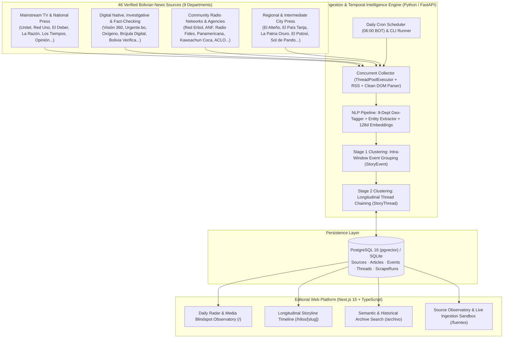
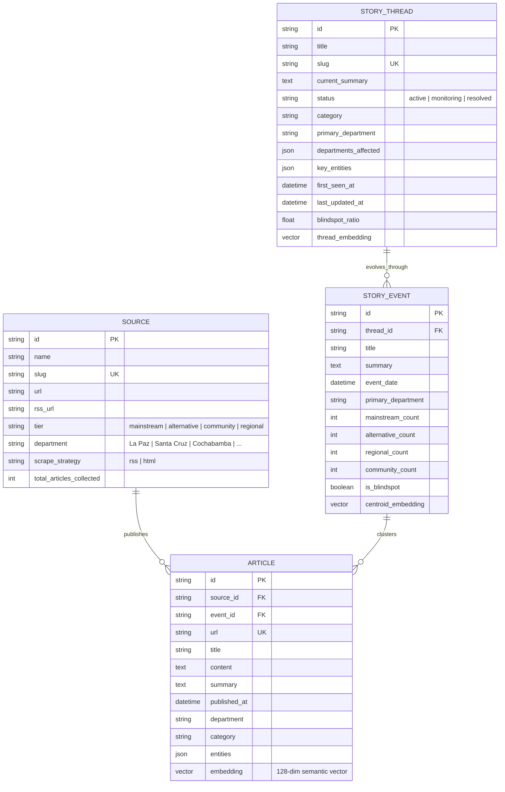

# Chasqui — Longitudinal News Aggregation & Media Blindspot Intelligence Platform

[](https://nextjs.org/)
[](https://react.dev/)
[](https://www.typescriptlang.org/)
[](https://fastapi.tiangolo.com/)
[](https://www.python.org/)
[](https://github.com/pgvector/pgvector)

**Chasqui** (named after the agile messengers of the Andean road system who connected distant regions) is a full-stack news intelligence and longitudinal tracking platform built to solve **media fragmentation, regional underrepresentation, and short-term news amnesia in Bolivia**.

Instead of presenting an ephemeral stream of isolated headlines, Chasqui ingests articles daily from **46 verified Bolivian news sources**—spanning mainstream television/newspapers, independent digital journalism, community radio networks, and regional press across all **9 departments**—and uses a **two-stage semantic clustering engine** to chain daily reports into evolving chronological timelines (`Articles` → `Events` → `Story Threads`).

---

## Why Chasqui Exists (Problem Statement)

In Bolivia, the information ecosystem suffers from three structural gaps:

1. **Geographic & Editorial Centralization (Media Blindspots):**
   Major television networks and legacy national newspapers concentrate their coverage on the central metropolitan axis. Critical developments in intermediate cities (such as El Alto, Montero, or Yacuiba), provincial municipalities, and rural territories are frequently covered only by local digital portals, regional newspapers, or community radio stations—never reaching national visibility.
2. **Fragmentation Across 40+ Independent & Regional Outlets:**
   Valuable investigative journalism, fact-checking, and grassroots reporting are scattered across dozens of heterogeneous websites and RSS feeds with no unified index or cross-source comparison.
3. **Ephemeral Headlines vs. Evolving Realities:**
   Standard news aggregators treat every article as a disconnected item. When a social conflict, judicial investigation, municipal budget crisis, or environmental emergency spans weeks or months, readers lose the historical thread of how the issue started, what agreements were signed, and how it evolved over time.

**Chasqui bridges this gap** by centralizing national and regional reporting into a single searchable observatory, automatically linking new daily developments to existing historical storylines, and quantifying the coverage balance between mainstream media and alternative/regional/community press.

---

## Key Engineering Highlights

- **Three-Tier Temporal Information Architecture:**
  Models news not as flat documents, but as a hierarchical graph:
  - **`Article`**: Individual source publication enriched with geographic department detection, named entities, thematic category, extractive summary, and a 128-dimensional semantic embedding vector.
  - **`StoryEvent`**: Time-windowed cluster ($\pm 96\text{h}$) grouping articles from multiple outlets that report on the same concrete occurrence, computing source-tier distribution.
  - **`StoryThread`**: Longitudinal storyline chaining sequential `StoryEvent` milestones over weeks or months to track the full lifecycle of a public issue.
- **Two-Stage Semantic & Entity Clustering Engine (`Python` / `NumPy` / `pgvector`):**
  Combines Spanish morphological stem normalization, domain-specific concept vectors, feature hashing of unigrams/bigrams, cosine similarity, named-entity overlap, and geographic weighting to automatically assign incoming articles to active events and link new events to historical threads.
- **Media Blindspot Detection & Coverage Asymmetry Metrics:**
  Classifies every source into four editorial tiers (`mainstream`, `alternative`, `community`, `regional`) and computes per-event and per-thread coverage ratios, surfacing **"Blindspot Events"** (*Puntos Ciegos*) that have $0\%$ coverage in traditional mass media.
- **High-Concurrency Multi-Strategy Scraper (`httpx` + `ThreadPoolExecutor` + `BeautifulSoup` + `feedparser`):**
  Scans **46 real Bolivian news portals** in parallel (~6 seconds per full national sweep), supporting both RSS/Atom syndication and heuristic DOM extraction with noise/navigation filtering and automated daily scheduling (`APScheduler` at `06:00 BOT`).
- **Performance-First & Accessible Editorial Web UI (`Next.js 15` + `React 19` + `Tailwind CSS v4`):**
  Implements `content-visibility: auto` paired with `contain-intrinsic-size` for zero-CLS off-screen feed rendering, native `<details>`/`<summary>` disclosures for Find-in-Page searchable source attributions, semantic `<search>` landmarks, and parallelized API data fetching.

---

## System Architecture



---

## Data Model (`PostgreSQL + pgvector` / `SQLAlchemy 2.0`)



---

## Monorepo Structure

```text
Chasqui/
├── Makefile                    # Unified developer & operations commands
├── package.json                # Root convenience scripts
├── docker-compose.yml          # PostgreSQL 16 + pgvector container definition
├── .github/workflows/ci.yml    # Automated CI pipeline for Backend (Python) & Frontend (Next.js)
└── apps/
    ├── api/                    # Python 3.12+ / FastAPI Backend & Scraping Engine
    │   ├── Dockerfile          # Production container image (Railway / Render / Fly.io / Cloud Run)
    │   ├── railway.json        # Railway deployment configuration
    │   ├── requirements.txt
    │   └── app/
    │       ├── main.py         # FastAPI endpoints & APScheduler lifecycle
    │       ├── cli.py          # CLI runner (scan, status, seed)
    │       ├── models.py       # SQLAlchemy 2.0 ORM models
    │       ├── schemas.py      # Pydantic v2 data contracts
    │       ├── scraper/
    │       │   ├── catalog.py  # 46 verified Bolivian news outlets across 4 tiers
    │       │   └── engine.py   # Concurrent RSS & HTML extraction engine
    │       └── intelligence/
    │           ├── nlp.py      # Bolivian geo-detector, NER, category classifier & embeddings
    │           └── clustering.py # Two-stage temporal clustering & blindspot scoring
    └── web/                    # Next.js 15 (App Router) + React 19 + TypeScript + Tailwind CSS v4
        ├── vercel.json         # Vercel deployment configuration
        └── src/
            ├── app/
            │   ├── page.tsx                # Daily Radar, Thread Evolution & Blindspot Filters
            │   ├── threads/[slug]/page.tsx # Interactive Longitudinal Timeline View
            │   ├── archive/page.tsx        # Historical & Semantic Search Archive
            │   └── sources/page.tsx        # Source Directory & Live Article Clustering Sandbox
            ├── components/
            │   ├── Navbar.tsx
            │   ├── CoverageMeter.tsx       # Visual bar comparing Alternative/Regional vs. Mainstream
            │   └── EventCard.tsx           # Event summary with searchable <details> source list
            └── lib/
                ├── api.ts
                └── types.ts
```

---

## Quick Start

### Prerequisites
- **Python** `>= 3.11`
- **Node.js** `>= 20` & `npm`
- *(Optional)* **Docker** for PostgreSQL 16 + `pgvector` (falls back automatically to local SQLite `chasqui.db` out of the box with zero configuration).

### 1. Install Dependencies
```bash
make setup
```

### 2. Initialize Database & Run Live Scan Across 46 Bolivian Portals
```bash
make seed
```

### 3. Start Backend & Frontend Servers
```bash
# Terminal 1 — Start FastAPI + Daily Scheduler on http://localhost:8000
make dev-api

# Terminal 2 — Start Next.js Web Application on http://localhost:3000
make dev-web
```

### 4. CLI Operations
```bash
# Trigger an on-demand live scan of all 46 Bolivian news sources
make scan

# Inspect current database metrics and top evolving story threads
make status

# Run Python compilation & TypeScript static type checks
make check
```

---

## REST API Overview

| Method | Endpoint | Description |
| :--- | :--- | :--- |
| `GET` | `/api/health` | Service health and daily cron schedule status (`06:00 BOT`) |
| `GET` | `/api/overview` | Global metrics, blindspot counts, department breakdown, and last scrape run |
| `GET` | `/api/threads` | List evolving story threads filtered by department, category, blindspot ratio, or semantic query `q` |
| `GET` | `/api/threads/{slug}` | Full chronological timeline of a story thread with all nested events and source articles |
| `GET` | `/api/events` | List clustered events filtered by department, category, or `blindspot_only=true` |
| `GET` | `/api/articles` | Historical archive search by semantic/keyword query, date range, department, and media tier |
| `GET` / `POST` | `/api/sources` | List all 46 monitored Bolivian sources or register a new media outlet |
| `POST` | `/api/scrape/run` | Trigger an immediate concurrent scrape across all active sources |
| `POST` | `/api/articles/ingest` | Ingest a custom article and return its automatically assigned `StoryEvent` and `StoryThread` |

---

## Deployment

The monorepo is pre-configured for independent cloud deployment:

- **Frontend (`apps/web`) → Vercel:** Import the repository into Vercel with **Root Directory** set to `apps/web` and set `NEXT_PUBLIC_API_URL` to your backend URL.
- **Backend & Daily Scraper (`apps/api`) → Railway / Render / Fly.io:** Connect the repository with **Root Directory** set to `apps/api` (uses `apps/api/Dockerfile` and `apps/api/railway.json`). Set `DATABASE_URL` to a PostgreSQL (`pgvector`) instance for persistent production storage.
